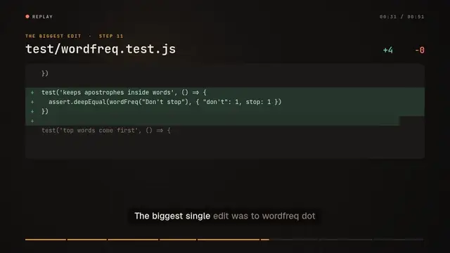

<p align="center"></p>

# trace-studio

[](https://github.com/VinVirtual/trace-studio/actions/workflows/test.yml) [](LICENSE)

Turn an AI agent run into a replay you can watch and share.

Give it a Claude Code session file, or an Anthropic or OpenAI message log. It removes private details first, then makes three things:

1. **`replay.html`**: one file you can send or attach. A timeline of the run with a play button, a scrubber, every tool call with its output folded away, and an inline diff of every file edit. It works offline and loads nothing from the network.
2. **`summary.mp4`**: a 30 to 60 second narrated video of how the agent solved the task, with captions. Drawn on a canvas in headless Chrome and voiced locally with Kokoro.
3. **`stats.json`**: time taken, steps, tool calls and failures, files and lines changed, tokens when the log has them, and what the anonymiser replaced.

It is packaged as a [Claude Code](https://claude.com/claude-code) skill (`SKILL.md` tells the assistant how to use it) and works by hand from the command line. Plain Node.js for the page and stats; no npm packages to install.


## The example

[`examples/wordfreq/`](examples/wordfreq/) is a complete worked example. Open [`out/replay.html`](examples/wordfreq/out/replay.html) in a browser, or watch [`out/summary.mp4`](examples/wordfreq/out/summary.mp4) (51.6 seconds, 1280×720, 3.3 MB).

The session is **fictional and scripted**. No model was called. [`make-session.mjs`](examples/wordfreq/make-session.mjs) plays an agent fixing a word counter: it writes a tiny project into a throwaway folder, really runs the tests (they really fail, twice), really applies three edits, and records every step in the Claude Code session format. The agent's sentences are written by hand. Tool durations are measured; the pauses while the "model" thinks are fixed numbers, and the token counts are estimates (characters ÷ 4). The throwaway folder's real path is swapped for a made-up one (`/home/dana/code/wordfreq`), and the made-up project contains made-up secrets (an email, an API key, a GitHub token, an internal host name and an IP address) so you can see them disappear: [`out/redaction.json`](examples/wordfreq/out/redaction.json) counts 56 replacements.

```bash
node examples/wordfreq/make-session.mjs            # writes examples/wordfreq/session.jsonl
./trace-studio build examples/wordfreq/session.jsonl --out examples/wordfreq/out
```

On this machine (16 cores, no GPU) the build took about 27 seconds: 8 scenes of narration, then 1,549 frames drawn in three browser pages in 12 seconds.

## Install

```bash
git clone https://github.com/VinVirtual/trace-studio ~/.claude/skills/trace-studio
~/.claude/skills/trace-studio/check_env.sh
```

| Needed | For |
|---|---|
| Node.js 18 or newer | everything |
| ffmpeg (on PATH, or the `imageio-ffmpeg` Python package) | the video |
| Playwright (`npm i -g playwright-core`) and Chrome or Chromium | the video |
| Python with `kokoro-onnx`, `soundfile`, `numpy`, and the Kokoro model files (about 340 MB) in `~/kokoro` | the narration (`--no-voice` works without) |

`check_env.sh` says exactly what to run for anything missing.

## Quick start

```bash
T=~/.claude/skills/trace-studio
$T/trace-studio list                                   # your Claude Code sessions, newest first
$T/trace-studio build latest --out run-replay --term "Client Name"
$T/trace-studio build path/to/log.json --out run-replay --no-video   # page and stats only, in seconds
```

`build` writes `redaction.json`, `stats.json`, `replay.html`, `story.json`, `summary.mp4`, `summary-poster.jpg` and `summary.vtt`. To change what the narrator says, edit the `say` lines in `story.json` and run `$T/trace-studio video run-replay/story.json`.

Other commands: `html`, `stats`, `story`, `video` (one output each), `redact` (an anonymised copy of the transcript), `scan` (look for private items in any file), `check`, `test`. `trace-studio help` lists every option.

## How it works

1. **Read.** JSON Lines or one JSON document. A line that is not valid JSON becomes a warning with its line number (a cut-off last line is reported as "the session may still be running"); the rest of the file is still read.
2. **Anonymise, first.** Each record is cleaned the moment it is parsed, before anything else looks at it: string values and object keys alike. See "What is replaced" below. The report keeps counts and line numbers, never the values.
3. **Parse.** Records become steps: the person's messages, the agent's replies, thinking (text left out by default), tool calls matched to their results by id, notes (interruptions, compaction). Times come from timestamps; tool durations are result time minus call time. Token usage is counted once per model message (Claude Code repeats it on every content block). File edits come from Claude Code's stored patches, or from the call's old and new text with a Myers line diff.
4. **Stats.** Counted from the steps. A value the log does not have is `null`, not zero.
5. **Replay page.** The styles, the script, one display font and the data go into one HTML file. The data sits in a `<script type="application/json">` block with `<`, `>` and `&` escaped, and the page builds every element with `textContent`, so a tool output that contains `<script>` shows as text. A content security policy allows only the page's own script and style (by hash) and blocks all network access.
6. **Story.** Scenes chosen from what the run contains (title, numbers, timeline of phases, tools, the first failure, the biggest edit, the end result) with one narration line each, filled in from counted facts.
7. **Video.** Kokoro speaks each line; the scene lengths follow the voice. A canvas page draws each frame as a pure function of time, three pages draw in parallel, and ffmpeg encodes H.264 with AAC audio, a quiet pad under the voice, a poster and WebVTT captions.
8. **Last check.** Every text file is scanned with the same patterns (plus this machine's user and host names and your terms) before it is written; if anything is found, nothing is written. `video` scans the story before drawing, because a story may have been edited by hand. The MP4 and the poster are drawn only from the scanned story; they are not scanned themselves.

### Inputs

| Format | Shape |
|---|---|
| Claude Code | `~/.claude/projects/<project>/<session>.jsonl`: one record per line (`user`, `assistant`, `system`, titles, and metadata records, which are skipped) |
| Anthropic Messages | `{ "messages": [...] }`, a list of messages, or one message per line; `text`, `thinking`, `tool_use`, `tool_result` blocks; response objects with `usage` |
| OpenAI Chat Completions | `{ "messages": [...] }` or a list; `tool_calls` with JSON `arguments`, `role: "tool"` replies, legacy `function_call` |
| OpenAI Responses | items of type `message`, `function_call`, `function_call_output`, `reasoning` |

### What is replaced

| Kind | Examples | Becomes |
|---|---|---|
| keys and tokens | `sk-…`, `AKIA…`, `aws_secret_access_key = …`, `ghp_…`, `github_pat_…`, `xoxb-…`, `AIza…`, Stripe, Hugging Face, npm, GitLab, JWTs, private key blocks, `Bearer …`, `password=…`, `user:pass@` in URLs, values of secret-named environment variables | `[redacted-key]` |
| emails | `dana@example.com` | `[redacted-email]` |
| project folder | the session's working folder | `<project>` (paths inside it are shown relative) |
| home folders | `/home/x`, `/Users/x`, `C:\Users\x`, `/root` | `~` |
| other absolute paths | under `/tmp`, `/var`, `/opt`, `/mnt`, `/srv`, `/data`, … | `/…/last-part` |
| user and host | this machine's user name and host name, user names seen in home folders in the log (`/home/alice/...` also replaces `alice` elsewhere), `me@box:~$` prompts, `*.local`, `*.internal`, `*.lan`, `*.corp` | `[redacted-user]`, `[redacted-host]` |
| IP addresses | IPv4 except `127.0.0.1` and `0.0.0.0` | `[redacted-ip]` |
| your words | every `--term` | `[redacted]` |

System paths (`/usr`, `/bin`, `/etc`, `/dev`) and URLs are kept. `--allow` keeps a value; `--keep-paths` and `--keep-ips` switch those kinds off.

## Limits

Read these before you share anything.

- **The anonymiser matches shapes, not meaning.** It cannot know that "Falcon" is a secret project, that a sentence describes a client, or that a pasted document is confidential. List such words with `--term`, and read the page before sharing it.
- **Unusual secrets slip through.** Host names on ordinary public domains (`db.example.com`) and IPv6 addresses are kept. A password in a sentence, a key in a format not listed above, a private key without its header line, base64-encoded credentials. The scan at the end uses the same patterns, so it cannot catch what they miss.
- **The narration is filled in from counts, not understood.** It says "a command failed" and "the same command ran without an error four steps later"; it does not know why. It never says what the task was in its own words: the title scene shows the person's first message instead. Edit `story.json` if you want more.
- **"Biggest edit" means most lines changed**, which is not always the most important change.
- **Times come from the log.** Wall time includes every pause, even days between a session and its resumption (`activeMs` caps idle gaps at 5 minutes). A tool's duration is the gap between its call and its result being written.
- **Thinking text is left out by default.** Claude Code often stores it empty anyway.
- **Images and attachments are not shown**, only marked.
- Other agent formats (LangChain traces, OpenTelemetry spans, Cursor or Aider logs) are not read.
- The video is a summary of counts and moments, not a screen recording.
- Tested on Linux with Node 24 (the CI workflow runs Node 22). The page was checked in Chromium only.

## Development

```bash
./trace-studio test     # 93 tests with node --test
```

The tests cover the anonymiser (every key format listed above, emails, home folders on three systems, paths, user and host names, IPs, terms, the allow list, hostile input that would make slow regular expressions hang), the parser (Claude Code records, Anthropic and OpenAI shapes, malformed and truncated lines, duplicates, orphaned results, usage counting, every kind of edit), diffs, the page (script injection in tool output, the security policy, no network loads, and in a real browser when Playwright is present: payloads show as text, nothing runs, the player moves), stats, the story and video timing, the command line in throwaway folders, and a 30,000-record session. The browser test is skipped on GitHub's runner, which has no Playwright; nothing else needs ffmpeg, a browser or Kokoro.

## Licence

MIT, see [`LICENSE`](LICENSE). Fonts are under the SIL Open Font License; see [`ASSETS.md`](ASSETS.md).
